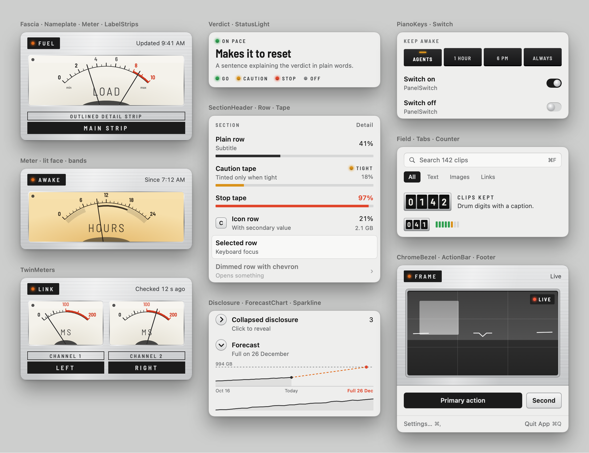
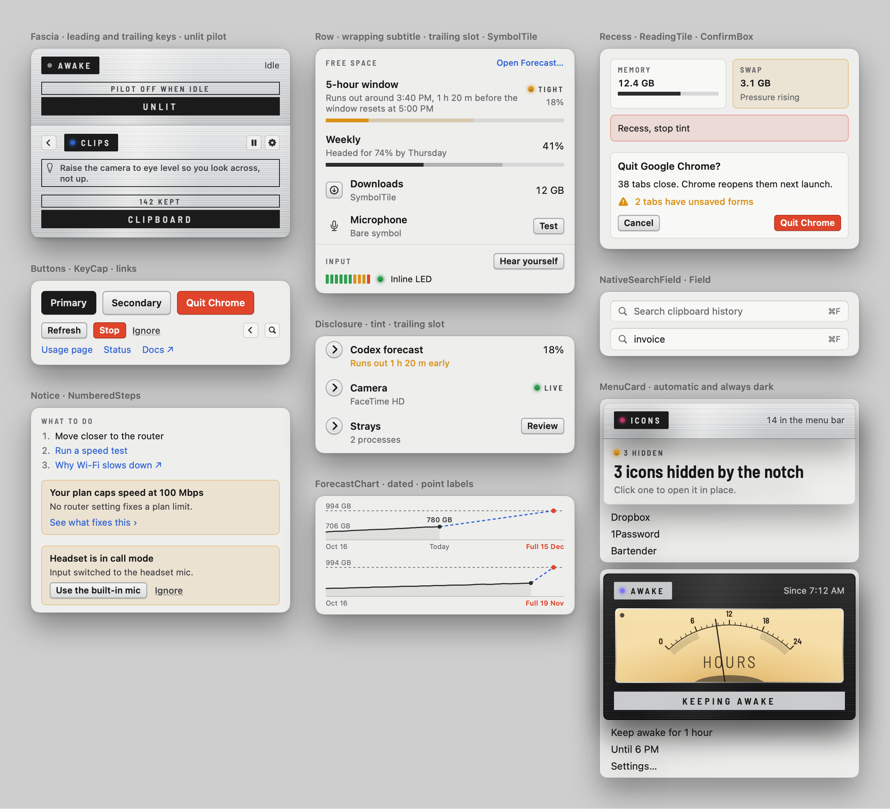

# PanelKit

Shared SwiftUI components for the menu bar popovers, in the Brushed style (brushed aluminium fascia, black anodised in dark mode, cream VU meters, reversed label strips, colour only in status lights, red zones and out-of-range values). Built for a family of free Mac menu bar apps (Fuel Gauge, Spare, Disk Forecast, Midnight Oil, WiFi or ISP, Green Room, On Hand, Coat Check).





The package lives at the repo root (`Package.swift`, sources in `Sources/PanelKit`). macOS 14+, Swift 6.

## Inspiration

PanelKit's look comes from vintage **Sony** tape decks and hi-fi gear of the late 1960s and 1970s: brushed-aluminium faceplates, black label strips, chrome knobs and bezels, cream VU meters with black needles, and colour used only for pilot lights and red zones. The meters, nameplates, label strips and piano keys here are an homage to those machines. The whole app family was designed with Sony's tape decks as the reference.

PanelKit is an independent project and is not affiliated with or endorsed by Sony. It borrows the materials and layout ideas only; it uses no Sony names, logos or nameplates.

## Add it to an app

In the app's `project.yml` (XcodeGen):

```yaml
packages:
  PanelKit:
    url: https://github.com/coreyhaines31/panelkit
    from: 0.2.0
targets:
  MyApp:
    dependencies:
      - package: PanelKit
```

In a Swift package: `.package(url: "https://github.com/coreyhaines31/panelkit", from: "0.2.0")`, then depend on the `PanelKit` product. Apps built as a bundle by hand should copy `PanelKit_PanelKit.bundle` into `Contents/Resources`; the fonts load from it. If it's missing, `PanelFont.register()` returns false and condensed text falls back to the condensed system font (no crash).

## Register the font

Plates, strips and meter scales use the bundled Barlow Semi Condensed (OFL). Register it once at launch:

```swift
import PanelKit

func applicationDidFinishLaunching(_ notification: Notification) {
    PanelFont.register()
}
```

Body text uses the system font.

## Minimal popover

```swift
import PanelKit
import SwiftUI

struct FuelPopover: View {
    var body: some View {
        Panel(accent: PanelAccent.fuelGauge) {
            Fascia(nameplate: "Fuel", timestamp: "Updated 9:41 AM", detail: "5-hour window", label: "Claude Code") {
                Meter(
                    MeterConfig(
                        majorTicks: 4, minorTicks: 4, zones: [0...0.12],
                        labels: [.init(0, "E"), .init(0.5, "½"), .init(1, "F")],
                        word: "LIMIT", accessibilityLabel: "Fuel meter"
                    ),
                    value: 0.62, accessibilityValue: "62 percent left"
                )
            }
            Verdict("Makes it to reset", message: "62% left. Resets at 1:00 PM.", status: .go, statusLabel: "On pace")
            SectionHeader("Codex", detail: "Pro plan")
            Row("5-hour window", subtitle: "Runs out around 3:40 PM", secondary: "18%",
                tape: RowTape(0.18, status: .caution)) {
                StatusLight(.caution, "Tight")
            }
            Disclosure("Forecast", subtitle: "Last 30 days") {
                Sparkline([41, 44, 52, 61, 62], accessibilityLabel: "Usage, last 30 days")
                    .padding(.horizontal, 14)
            }
        } footer: {
            Footer(appName: "Fuel Gauge", openSettings: { /* open settings */ }, quit: { NSApp.terminate(nil) })
        }
    }
}
```

`Panel` follows the colour scheme: aluminium in light, anodised with lit amber meters in dark. For a fixed-height window, pass `Panel(accent:fillsHeight: true)`.

## Card in a native menu

Menu bar apps that keep an `NSMenu` put a `MenuCard` on top of it: 330 pt wide, inset 5 pt in the 340 pt menu, 7 pt corners and a hairline ring.

```swift
import AppKit
import PanelKit
import SwiftUI

let card = MenuCard(accent: PanelAccent.coatCheck) {
    Fascia(nameplate: "Icons", timestamp: "14 in the menu bar")
    VerdictView("3 icons hidden by the notch", message: "Click one to open it in place.",
                status: .caution, statusLabel: "3 hidden")
}
menu.insertItem(.panelCard(card), at: 0)
```

Pass `appearance: .dark` for a card that is always black anodised (Midnight Oil).

## Components

| Component | Use |
|---|---|
| `Panel` | 340 pt container, 12 pt corners, footer slot; `fillsHeight` for fixed-height windows |
| `MenuCard`, `NSMenuItem.panelCard(_:)` | Brushed card at the top of a native `NSMenu`, optionally always dark |
| `Fascia`, `Nameplate`, `LabelStrips`, `BrushedMetal` | Metal header with pilot light (`isLit`), timestamp, `leadingAccessory`/`trailingAccessory` keys, instrument and strips |
| `KeyCap`, `KeyCapStyle` | 20 pt metal key for fascia toolbars |
| `TipStrip` | Outlined strip that wraps a full sentence |
| `Meter`, `MeterConfig`, `TwinMeters` | VU meter: sweep, ticks, red zones, labels, word, one or more animated needles, cream or lit face |
| `Verdict` (`VerdictView`), `StatusLight`, `StatusLED` | Status LED + word, bold title, sentence; bare LED for inline text |
| `SectionHeader` | Section label with detail, `actionTitle:action:` link or `trailingAccessory` |
| `Row`, `Tape`, `LetterTile`, `SymbolTile` | Readout rows with value column, tape (with optional `projection`), `subtitleLineLimit`, `trailingAccessory`, selected/dimmed/chevron states |
| `Disclosure` | Expandable row revealing any content; `subtitleTint`, `trailingAccessory` |
| `ForecastChart` (`PanelForecastChart`), `ForecastPoint`, `Sparkline` | Past line, dashed projection to a limit, today marker; dated points and point labels; Today gives way on collision |
| `Notice` | Caution-tinted card with title, sentence and actions |
| `NumberedSteps`, `NumberedStep` | Numbered next steps, actionable ones as links |
| `Recess`, `ReadingTile` | Recessed box (optional status tint); small stat tile |
| `ConfirmBox` | Consequence, Cancel (Esc) and a red action |
| `PianoKeys`, `Tabs`, `PanelChoice` | Segmented choices |
| `PanelSwitch`, `PanelSwitchStyle` | Toggle |
| `ActionBar`, `PanelButtonStyle` | Primary, secondary and destructive keys in `.regular` or `.compact` size (`.panelPrimary`, `.panelSecondary`, `.panelCompact`, `.panelDestructive`) |
| `PanelLinkStyle`, `LinkBar` | Text links in the link colour (or quiet underlined ink); a row of links |
| `Field`, `NativeSearchField` | Search field with shortcut hint; the AppKit-backed one handles ↑↓, Return, Esc and focus |
| `Counter`, `DrumDigits` | Tape-counter digits |
| `ChromeBezel`, `TallyLight`, `LevelMeter` | Live preview frame, tally, LED level (optional `stopFrom`) |
| `Footer` | Settings… ⌘, and Quit ⌘Q |
| `PanelTheme`, `PanelAccent`, `PanelStatus`, `\.panelTheme` | Colour tokens (including `link`), read from the environment |

Accessibility: meters, tapes and status lights expose labels and values; needles snap instead of springing under Reduce Motion.

## Migrating from 0.1

Nothing is removed; 0.1 code compiles with one deprecation warning.

- `PanelKit.registerFonts()` → `PanelFont.register()`. The `PanelKit` enum is gone, so `PanelKit.Verdict` and `PanelKit.ForecastChart` now resolve to the module's types. The old call still compiles (deprecated) until 0.3.
- If an app has its own `Verdict` or `ForecastChart`, use `VerdictView` / `PanelForecastChart` (or `PanelKit.Verdict`) instead of a local typealias.
- Replace local `PanelTheme.resolve(colorScheme)` environment helpers with `@Environment(\.panelTheme)`.
- Replace local copies with the shared pieces: inset menu cards → `MenuCard`; fascia copies for an unlit pilot or header keys → `Fascia(isLit:)` with `leadingAccessory`/`trailingAccessory`; small in-row keys → `.panelCompact`; red keys → `.panelDestructive`; symbol keys → `KeyCap`; link styles → `PanelLinkStyle`/`LinkBar`; wrapping rows → `Row(...).subtitleLineLimit(2)`; projected tapes → `Tape(_:projection:)`; and `Notice`, `NumberedSteps`, `ConfirmBox`, `Recess`, `ReadingTile`, `TipStrip`, `SymbolTile`, `StatusLED`, `NativeSearchField` for their local counterparts.
- `ForecastChart` now hides the Today label when it would run into the start or end label, so apps that blanked it by hand can stop.

See `CHANGELOG.md` for the full list.

## Gallery

```sh
swift run PanelKitGallery docs/gallery
```

Renders every component (`components-*`, and the 0.2 additions in `additions-*`) and a sample popover per app, light and dark, at 2x. Set `.environment(\.panelSnapshot, true)` when snapshotting your own popovers with `ImageRenderer` so `Field` draws without AppKit.

## Licence

Code: MIT (see `LICENSE`). The bundled Barlow Semi Condensed font is under the SIL Open Font License (`Sources/PanelKit/Resources/Fonts/OFL.txt`).
